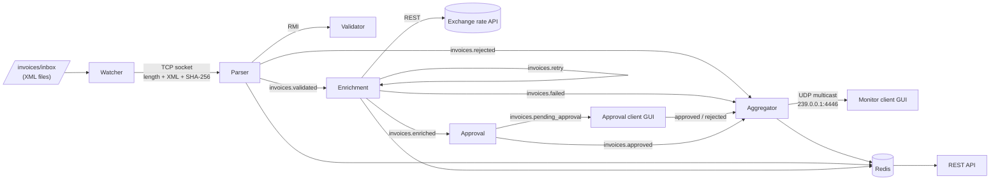

# invoice-processing-system

A distributed system for automated invoice processing, built in Java as the project for the *Network and Distributed Programming* course at the Faculty of Electrical Engineering, University of Banja Luka.

Each processing stage is an independent Java service. The services communicate over different network protocols — TCP sockets, Java RMI, a message broker (ActiveMQ), UDP multicast and HTTP — and every service logs its actions so the whole pipeline can be followed in real time.

## Architecture



## Modules

| Module | Role | Communication |
|---|---|---|
| `common` | Shared invoice model and utilities used by all services | — |
| `watcher` | Watches `invoices/inbox`, reads new XML files, computes a SHA-256 hash and sends them to the Parser; moves files to `invoices/processed` after the ACK. Buffers bursts of hundreds of files without losing any or overloading the next stage. | TCP client |
| `parser` | Socket server: verifies the SHA-256 integrity, parses the XML, checks Redis for duplicate invoice IDs and calls the Validator. Publishes valid invoices as JSON or rejects them with a list of errors. | TCP server, RMI client, ActiveMQ, Redis |
| `validator` | Validates the JIB (13 digits), date (not in the future, not older than 365 days), items, currency (BAM, EUR, USD, CHF, GBP), total amount and e-mail format. | Java RMI |
| `enrichment` | Converts the invoice total to BAM using a public exchange rate API, with a one-hour Redis cache (`rate:{currency}:{date}`). If the API is unavailable, invoices go to a retry topic and are retried with a delay up to 3 times before being marked `RATE_UNAVAILABLE`. | ActiveMQ, REST client, Redis |
| `approval` | Auto-approves invoices up to 100 BAM; larger ones wait for a manual decision. | ActiveMQ |
| `approval-client` | Desktop GUI that shows pending invoices and lets the user approve or reject them (a reason is required for rejection). | ActiveMQ |
| `aggregator` | Consumes all topics, stores every invoice in Redis (`invoice:{id}`), keeps per-client totals (`client:{jib}`) and sends a multicast notification for every approved invoice. | ActiveMQ, Redis, UDP multicast |
| `monitor-client` | Desktop GUI that joins the multicast group and shows notifications in a live table. Any number of instances can run at once. | UDP multicast |
| `restapi` | Read-only HTTP server on top of Redis. | HTTP / JSON |

### Message topics

`invoices.validated` · `invoices.rejected` · `invoices.retry` · `invoices.enriched` · `invoices.pending_approval` · `invoices.approved` · `invoices.failed`

### REST API

| Endpoint | Description |
|---|---|
| `GET /api/invoices` | All processed invoices |
| `GET /api/invoices/{id}` | A single invoice |
| `GET /api/invoices?status={status}` | Filter by `approved`, `rejected`, `failed` or `pending` |
| `GET /api/clients/{jib}/summary` | Total BAM, invoice count and last invoice for a client |
| `GET /api/stats` | Total invoices, total BAM, average amount, number pending |

## Tech stack

Java · Maven (multi-module) · TCP and UDP sockets · UDP multicast · Java RMI · Apache ActiveMQ · Redis · REST · Docker Compose

## Running the system

**Requirements:** JDK, Maven, Docker

1. Start Redis and ActiveMQ:
   ```bash
   docker compose up -d
   ```
   Redis runs on port `6379`, ActiveMQ on `61616` (web console on http://localhost:8161).

2. Build all modules from the project root:
   ```bash
   mvn clean install
   ```

3. Start the services in this order (each module has its own main class):
   1. `validator`
   2. `parser`
   3. `enrichment`
   4. `approval`
   5. `aggregator`
   6. `restapi`
   7. `approval-client` and one or more `monitor-client` instances
   8. `watcher`

4. Copy XML invoices into `invoices/inbox` and follow the processing in the logs, the GUI clients and the REST API.

## Example invoice

```xml
<?xml version="1.0" encoding="UTF-8"?>
<invoice>
  <id>INV-2025-001</id>
  <client>
    <name>ETF</name>
    <jib>1234567891012</jib>
    <email>fakture@etf.com</email>
  </client>
  <date>2025-05-01</date>
  <currency>EUR</currency>
  <items>
    <item>
      <description>Web development</description>
      <quantity>10</quantity>
      <unitPrice>50.00</unitPrice>
    </item>
    <item>
      <description>Hosting</description>
      <quantity>1</quantity>
      <unitPrice>120.00</unitPrice>
    </item>
  </items>
</invoice>
```

## Author

Sonja Galić — [github.com/Sonja03](https://github.com/Sonja03)
